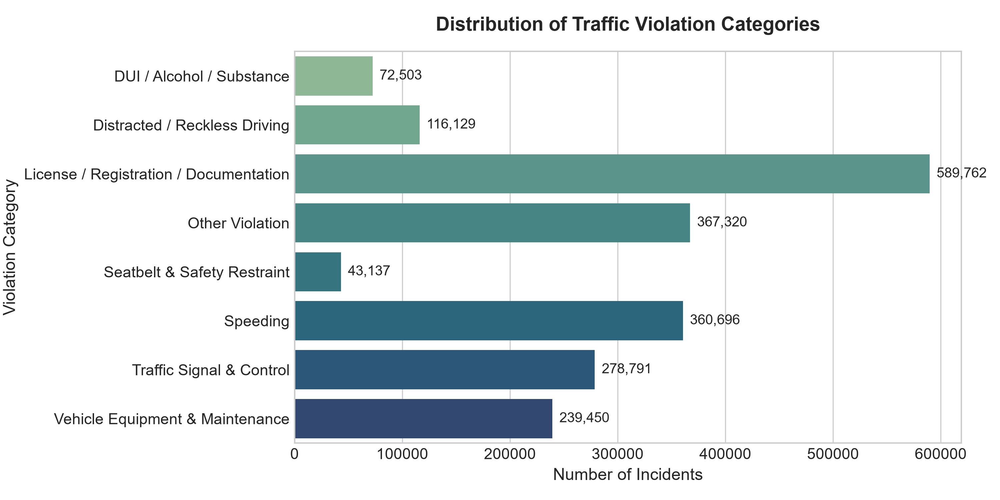
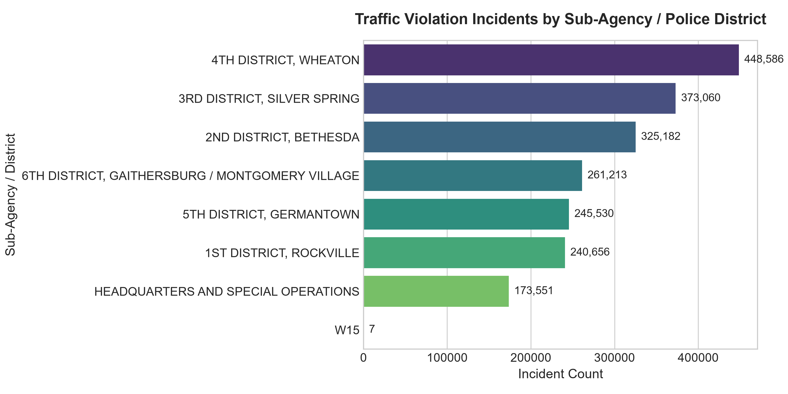
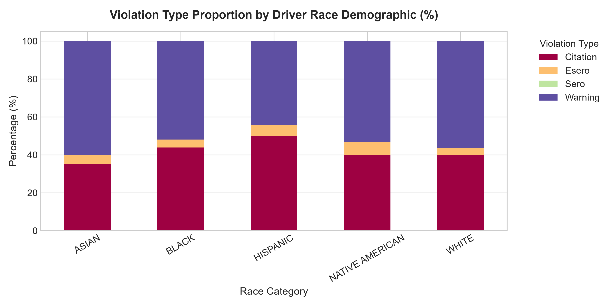
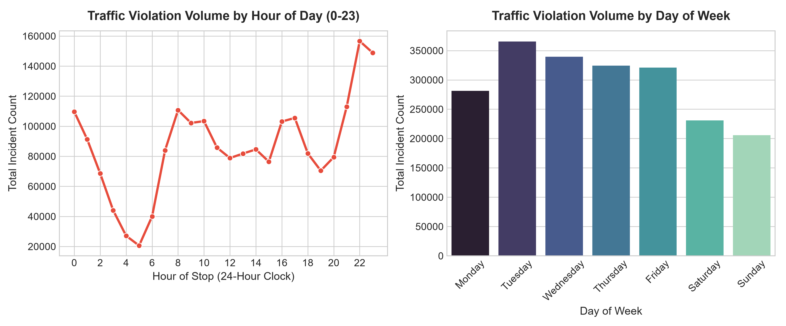
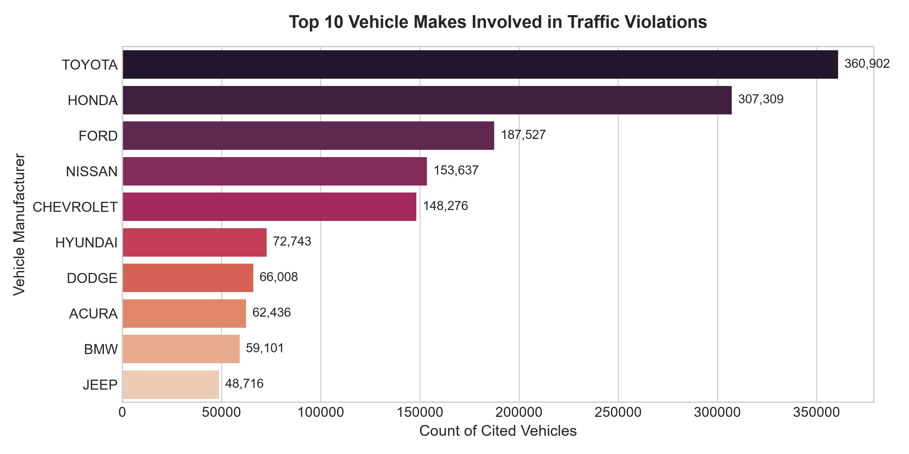
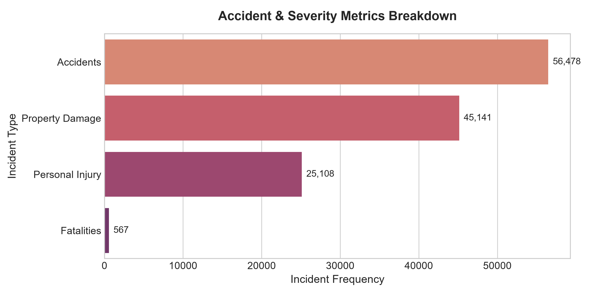

# Exploratory Data Analysis (EDA) Report: Traffic Violations Insight System

## Executive Summary
This report summarizes the exploratory data analysis conducted on the Montgomery County Traffic Violations dataset (~2,067,788 cleaned rows, representing 1,178,080 distinct traffic stops).

- **Total Violations Processed**: 2,067,788
- **Unique Traffic Stops**: 1,178,080
- **Accident Involvements**: 56,478 (2.73%)
- **Personal Injuries Recorded**: 25,108
- **Property Damage Incidents**: 45,141
- **Fatal Incidents**: 567

---

## 1. Most Common Violations
The single largest category of violations cited is **License / Registration / Documentation** with **589,762** records.

---

## 2. High-Incident Geographic Hotspots & Districts
Enforcement activity is concentrated heavily in urban districts. The sub-agency with the highest recorded traffic stops is **4TH DISTRICT, WHEATON** with **448,586** citations/warnings.

---

## 3. Demographic & Citation Breakdown
Analysis of driver demographics against violation disposition shows consistent distributions, with Citations accounting for the vast majority of enforcement actions across all demographics.

---

## 4. Temporal Patterns (Hourly & Weekly Variance)
- **Peak Enforcement Hours**: Traffic stops peak between 21:00 (9 PM) and 01:00 (1 AM), as well as during morning rush hours (07:00 - 09:00).
- **Weekly Volume**: Traffic stop activity remains high Wednesday through Friday, with a slight shift in offense type over weekend late-night hours.

---

## 5. Vehicle Profiling
The top cited vehicle manufacturer is **TOYOTA** (360,902 citations), followed by HONDA, FORD, NISSAN, CHEVROLET.

---

## 6. Accident & Severity Analysis
Out of 2,067,788 total violations, **56,478** stops involved a vehicle collision.

---

## Strategic Recommendations
1. **Targeted Patrol Allocation**: Increase enforcement presence in high-density districts (e.g. 3rd District Silver Spring, 4th District Wheaton) during peak night-time hours (21:00 - 01:00).
2. **Speed & Safety Campaigns**: Prioritize public safety messaging on Speeding and License/Registration compliance.
3. **Accident Mitigation**: Deploy mobile speed cameras near high accident-severity intersections.
